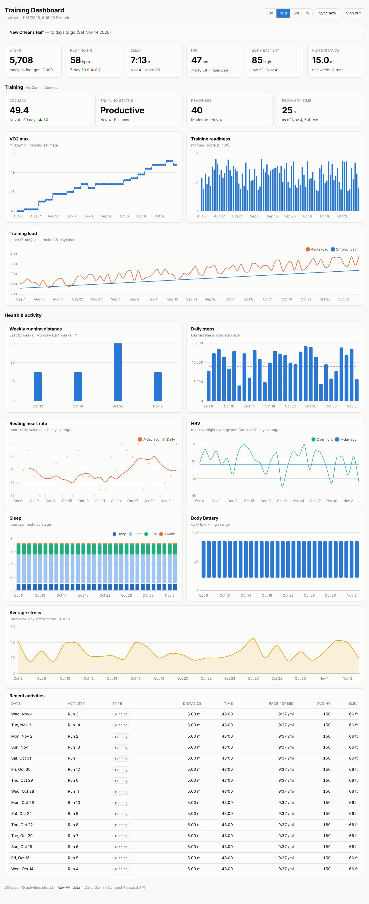

# Garmin Dashboard for Unraid

A private, self-hosted dashboard for your own Garmin data.

- **Garmin's official Personal API** supplies steps, resting heart rate, sleep,
  HRV, Body Battery, stress and activities.
- **Optional Garmin Connect sign-in** adds what the official API leaves out:
  VO2 max, training status, training readiness, recovery time and training load.

Everything stays on your server. The only things sent anywhere are the
requests to Garmin that fetch your data.



---

## Install on Unraid (about 10 minutes)

### 1. Create your Garmin Personal API key

On a computer, sign in at **https://connect.garmin.com/app/settings/personalApiToken**,
choose **Create Key**, accept the terms and pick **1 year**. Copy the key. Garmin
shows it only once. Keep it handy for step 4.

### 2. Add the template to Unraid

Open the Unraid terminal (the `>_` icon, top right), paste this, and press Enter:

```bash
wget -O /boot/config/plugins/dockerMan/templates-user/my-garmin-dashboard.xml https://raw.githubusercontent.com/itsaggo/garmin-dashboard/main/unraid/garmin-dashboard.xml
```

### 3. Create the container

**Docker** tab → **Add Container** → open the **Template** dropdown → under
*User templates* pick **garmin-dashboard**. Set your time zone and units (and an
optional race countdown), then click **Apply**.

It now appears in the Docker tab with your other containers, with its own icon,
Autostart switch and WebUI link.

### 4. Run the setup

Back in the Unraid terminal:

```bash
docker exec -it garmin-dashboard python -m app.setup
```

It asks for:

1. **A dashboard password**, at least 12 characters (a short sentence works well).
2. **Your Personal API key** from step 1. It checks the key with Garmin before saving.
3. **Optionally, your Garmin Connect email and password** for VO2 max, training
   status and recovery. Your password is used once to sign in and is **never saved**.
   If you use two-factor sign-in, it asks for the code.

Nothing you type is shown on screen.

### 5. Open it

In the Docker tab, click the dashboard's icon → **WebUI**, or go to
`http://YOUR-SERVER-IP:8099`. Use the IP shown in the Docker tab's *LAN IP:PORT*
column. Sign in with your dashboard password.

The first sync fetches a year of history and takes a few minutes. Training
metrics fetch 90 days of history and take a few minutes more.

---

## Updating

Docker tab → **Check for Updates** → **Apply Update** on garmin-dashboard.
Your data, password and Garmin sign-ins are kept.

## Everyday commands

Run these in the Unraid terminal:

| Task | Command |
|---|---|
| Change dashboard password | `docker exec -it garmin-dashboard python -m app.setup password` |
| Replace an expired API key | `docker exec -it garmin-dashboard python -m app.setup api-key` |
| Re-connect Garmin Connect | `docker exec -it garmin-dashboard python -m app.setup connect` |
| Remove Garmin Connect sign-in | `docker exec -it garmin-dashboard python -m app.setup disconnect` |
| Sign out every browser | `docker exec -it garmin-dashboard python -m app.setup logout-all` |
| See what's set up | `docker exec garmin-dashboard python -m app.setup status` |
| Re-pull all history | `docker exec garmin-dashboard python -m app.sync --full` |

To change a setting (time zone, units, race), use the container's **Edit** in the Docker tab.

**Things that expire:** the Personal API key (Garmin emails you a week before)
and the Garmin Connect sign-in (typically after months). When either lapses, the
dashboard shows a banner with the exact command to fix it, and the other data
source keeps working.

---

## Security

What protects your data:

- **Login required for everything.** That includes the API and the page code.
  Passwords are stored only as a salted scrypt hash. Sessions are random
  server-side tokens in an `HttpOnly`, `SameSite=Strict` cookie. They last 30
  days, and you can revoke them.
- **Brute-force limits.** 5 attempts per address and 20 overall per 15 minutes.
  Each attempt is counted before the password is checked, so firing many at once
  doesn't earn extra tries. At most two password checks run at a time, so a
  flood can't exhaust the server's memory.
- **Cross-site protection.** Every form or button action is checked to make
  sure it came from the dashboard itself. A strict Content-Security-Policy
  allows only the dashboard's own scripts: no inline code and no third-party
  resources. The page can't be embedded in other sites. Requests addressed to
  unknown domain names are refused, which blocks "DNS rebinding" attacks from
  websites you visit.
- **No secrets in settings or environment variables.** `docker inspect` shows
  nothing sensitive. Secrets live in `data/secrets/` (folder 0700, files 0600),
  and only the setup command writes them.
- **Your Garmin password is never stored.** Only the sign-in token Garmin issues
  is kept, and you can delete it any time with `setup disconnect`.
- **Locked-down container.** The app runs as Unraid's unprivileged `nobody`
  user with no Linux capabilities. Starting from the Docker tab, the container
  briefly has three: enough to hand the data folder to `nobody` and switch to
  that user. It drops them before the app starts. The filesystem is read-only,
  privilege escalation is blocked, and process count and memory are capped.
- **Verified dependencies.** Every Python package is checked against SHA-256
  hashes when the image is built. Images are built by GitHub Actions from this
  repository's source, after the test suite passes. The Debian base image is
  pulled fresh at each release build and gets Debian's security updates. That
  trades exact reproducibility for staying patched.
- **Read-only toward Garmin.** Nothing in this app changes your Garmin account.

What it can't protect against, and what you should do:

- **Plain HTTP on your LAN.** Traffic on your home network isn't encrypted.
  Don't port-forward 8099 on your router. For access away from home, use
  **Tailscale** or **WireGuard** (Unraid has both) instead of exposing the port.
  - **Behind an HTTPS reverse proxy:** set *Secure cookies* to `true`, and set
    *HTTPS reverse-proxy address* to its exact public address, e.g.
    `https://garmin.example.com`. The proxy also has to pass the original Host
    header. Nginx Proxy Manager and SWAG already do. For plain nginx, add
    `proxy_set_header Host $host;` and put the domain in *Allowed host names*.
- **The lockout is shared.** The 20-tries limit applies to everyone, so a device
  on your network spamming wrong passwords could lock you out for 15 minutes
  too. Restarting the container clears it.
- **Anyone with root on your Unraid server can read the data folder.** That's
  true of every app on the server, so keep your Unraid root password strong.
- **The Garmin Connect part is unofficial.** It uses the community
  [`garminconnect`](https://github.com/cyberjunky/python-garminconnect) library,
  not a Garmin-supported API. It only reads data, but Garmin could change or
  block it. If that happens, the official half keeps working.
- **The data folder isn't encrypted on disk.** If you want that, use Unraid's
  encrypted array or pool.

---

## Troubleshooting

- **The page times out**: use the IP in the Docker tab's *LAN IP:PORT* column. If
  your server has more than one network connection, it may be a different
  address from the one you expected.
- **"This address (…) isn't allowed"**: you opened it by a name rather than an
  IP. Add that name to *Allowed host names* (container → Edit), or use the IP.
- **Apply fails with "denied" or "not found" when pulling the image**: the image
  isn't public yet (see *Publishing* below), or the template still contains
  `itsaggo`.
- **A chart says "No data yet"**: open `/raw` in the dashboard to see exactly what
  Garmin sent. A field name Garmin hasn't documented may need adding to
  `app/extract.py`.
- **"Too many attempts" on the login page**: wait 15 minutes, or restart the container.
- **Login says the server is busy**: someone else is trying passwords at the same
  moment. Wait a few seconds and try again.
- **Garmin Connect sign-in says "too many attempts"**: Garmin limits logins.
  Wait 15–30 minutes before trying again.

## Uninstall

1. Docker tab → click the icon → **Remove** (tick *also remove image*).
2. In the terminal:

   ```bash
   rm -rf /mnt/user/appdata/garmin-dashboard   # deletes your stored data
   rm /boot/config/plugins/dockerMan/templates-user/my-garmin-dashboard.xml
   ```
3. Delete the Personal API key at connect.garmin.com (Settings → Personal API).

---

## Publishing (for the maintainer)

**First time:**

1. Replace `itsaggo` everywhere with your GitHub username in
   **lowercase**. The container registry requires lowercase.
2. Push to GitHub.
3. On GitHub: **Releases** → **Draft a new release** → tag `v1.0.0` → **Publish**.
   The *Release image* workflow runs the tests, then builds and pushes
   `ghcr.io/<you>/garmin-dashboard` (watch it under **Actions**).
4. Make the image public so Unraid can download it. On your GitHub profile →
   **Packages** → **garmin-dashboard** → **Package settings** →
   **Change visibility** → **Public**.

**Every update:** commit and push your changes, then publish a new release with a
higher version (`v1.0.1`, `v1.1.0`, …). Unraid servers then show "update
available".

The *Tests* workflow runs on every push. To run them locally:

```bash
pip install --require-hashes --no-deps -r requirements.lock && pip install pytest httpx
python -m pytest -q tests
```

## Build from source instead (advanced)

To build the image on the server itself, without GitHub's image: copy this
folder to `/mnt/user/appdata/garmin-dashboard` and run
`bash /mnt/user/appdata/garmin-dashboard/install.sh`. Settings then live in
`config.env`, which is created from `config.example.env` on the first run.
Re-run the script to apply changes. A container made this way appears in the
Docker tab without an icon or update checks.

## Project layout

```
app/
  main.py      web server, login, security headers, background scheduler
  auth.py      password hashing, sessions, login rate limiting
  setup.py     interactive setup command
  sync.py      official Personal API sync (chunked ranges, backoff, token refresh)
  connect.py   optional Garmin Connect sync (VO2 max, training status, readiness)
  extract.py   Garmin JSON → tidy rows
  db.py        SQLite storage
  static/      dashboard front end (plain JS + bundled Chart.js)
unraid/        Docker-tab template and icon
entrypoint.sh  drops to the unprivileged user before the app starts
tests/         pytest suite + a fake Garmin API (tests/mock_garmin.py)
.github/       test and release workflows
```

MIT licensed (see `LICENSE`). Third-party components are listed in
`THIRD_PARTY_NOTICES.md`. Not affiliated with or endorsed by Garmin.
